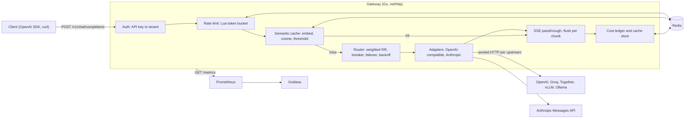

# LLM Gateway

[](https://github.com/Bhavd33p/llm-gateway/actions/workflows/ci.yml)

An OpenAI-compatible proxy in Go that sits in front of several LLM providers. Clients keep using the OpenAI API
(any OpenAI SDK works by changing `base_url`); the gateway adds:

* **Weighted routing and automatic failover** across upstreams (smooth weighted round-robin, a circuit breaker per
  upstream, retries with exponential backoff and full jitter, and retries only before the first byte reaches the client).
* **Streaming passthrough**: server-sent events are flushed chunk by chunk, and a client disconnect cancels the
  upstream request.
* **Connection pooling**: one tuned `http.Transport` per upstream.
* **A semantic cache in Redis**: requests are embedded and a cached answer is served when cosine similarity reaches a
  per-tenant threshold, with an LRU index and TTLs.
* **Per-tenant token-bucket rate limiting**, one atomic Lua script that uses Redis server time.
* **Cost accounting**: a price table per model and a per-tenant monthly ledger in integer micro-dollars.
* **Prometheus metrics** for cache hit rate, time to first token, per-upstream latency percentiles, per-tenant spend,
  failovers and rate-limit rejections, plus a Grafana dashboard.

Adapters: any OpenAI-compatible API (OpenAI, Groq, Together, vLLM, Ollama) and the Anthropic Messages API, translated
in both directions. A mock provider and a load generator are included, and [BENCHMARKS.md](BENCHMARKS.md) records
measured results. New to the code? Start with [docs/WALKTHROUGH.md](docs/WALKTHROUGH.md).

## Architecture



## Quickstart

### Local (Go 1.26+, Redis)

```sh
make build
redis-server                       # in one terminal (localhost:6379)
make mocks                         # in another: mock upstreams on :9001 and :9002
./bin/gateway -config config.example.yaml
```

```sh
curl -N http://localhost:8080/v1/chat/completions \
  -H "Authorization: Bearer demo-key-acme" \
  -H "Content-Type: application/json" \
  -d '{"model":"gpt-4o-mini","stream":true,"messages":[{"role":"user","content":"What is the capital of France?"}]}'
```

Run it a second time (try different capitalisation) and the response comes back with `X-Cache: HIT`.

### Docker Compose (gateway, Redis, two mocks, Prometheus, Grafana)

```sh
docker compose up --build
```

| Service | URL |
|---|---|
| Gateway | http://localhost:8080 |
| Prometheus | http://localhost:9090 |
| Grafana (anonymous viewer, dashboard "LLM Gateway") | http://localhost:3300 |

### Real providers

Uncomment an upstream in the config, put its key in `.env` (see `.env.example`), and point the client at the gateway:

```python
from openai import OpenAI

client = OpenAI(base_url="http://localhost:8080/v1", api_key="demo-key-acme")
stream = client.chat.completions.create(
    model="gpt-4o-mini", stream=True, messages=[{"role": "user", "content": "Hello"}]
)
for chunk in stream:
    if chunk.choices:
        print(chunk.choices[0].delta.content or "", end="")
```

## API

| Endpoint | Purpose |
|---|---|
| `POST /v1/chat/completions` | OpenAI chat completions, streaming (`"stream": true`) and non-streaming |
| `GET /v1/usage` | The calling tenant's ledger for the current month |
| `GET /metrics` | Prometheus metrics |
| `GET /healthz` | Liveness |
| `GET /readyz` | Readiness (pings Redis) |

Authentication: `Authorization: Bearer <key>` (what OpenAI SDKs send) or `X-API-Key: <key>`.

Request header `Cache-Control: no-cache` skips the semantic cache. Response headers:

| Header | Meaning |
|---|---|
| `X-Cache` | `HIT`, `MISS` or `BYPASS` |
| `X-Cache-Similarity` | Cosine similarity of the cached entry that was served |
| `X-Upstream` | Upstream that served the request |
| `Retry-After` | Seconds to wait, on `429` responses |

Errors use the OpenAI shape, `{"error": {"message": "...", "type": "..."}}`: `401` unknown key, `429` rate limited,
`502` every attempt failed, `503` every circuit breaker open, and upstream `4xx` passed through. If a stream breaks
after the first chunk, the client receives an in-band `data: {"error": ...}` event and no `[DONE]`.

More examples:

```sh
# Non-streaming
curl http://localhost:8080/v1/chat/completions -H "Authorization: Bearer demo-key-acme" \
  -d '{"model":"gpt-4o-mini","messages":[{"role":"user","content":"Name a prime number"}]}'

# Bypass the cache
curl -N http://localhost:8080/v1/chat/completions -H "Authorization: Bearer demo-key-acme" \
  -H "Cache-Control: no-cache" -d '{"model":"gpt-4o-mini","stream":true,"messages":[{"role":"user","content":"hi"}]}'

# Spend so far this month
curl http://localhost:8080/v1/usage -H "Authorization: Bearer demo-key-acme"

# Watch the rate limiter (globex: 5 req/s, burst 10): 15 parallel requests give 10 x 200 and 5 x 429
for i in $(seq 1 15); do curl -s -o /dev/null -w "%{http_code}\n" http://localhost:8080/v1/chat/completions \
  -H "Authorization: Bearer demo-key-globex" -H "Cache-Control: no-cache" \
  -d '{"model":"gpt-4o-mini","messages":[{"role":"user","content":"hi"}]}' & done | sort | uniq -c
```

## Configuration

One YAML file (`-config`, default `config.example.yaml`). Unknown keys are rejected. Durations use Go syntax (`50ms`, `10s`, `24h`).

| Key | Default | Meaning |
|---|---|---|
| `server.addr` | `:8080` | Listen address |
| `server.max_body_bytes` | `1048576` | Request body limit |
| `server.shutdown_timeout` | `30s` | How long SIGTERM/SIGINT waits for in-flight requests and streams |
| `redis.addr`, `redis.db`, `redis.pool_size` | `localhost:6379`, `0`, go-redis default | Redis connection |
| `redis.password_env` | | Environment variable holding the Redis password |
| `routing.max_attempts` | `3` | Attempts per request across upstreams, including the first |
| `routing.backoff_base`, `routing.backoff_max` | `50ms`, `1s` | Full-jitter backoff: retry n sleeps `rand(0, min(max, base * 2^n))` |
| `routing.breaker_failure_threshold` | `5` | Consecutive failures that open an upstream's circuit |
| `routing.breaker_cooldown` | `10s` | Wait before an open circuit lets one probe through |
| `upstreams[].name` | | Unique name, used in metrics and `X-Upstream` |
| `upstreams[].type` | | `openai` (any OpenAI-compatible API) or `anthropic` |
| `upstreams[].base_url` | | e.g. `https://api.openai.com/v1`, `https://api.anthropic.com` |
| `upstreams[].api_key_env` | | Environment variable holding the provider key (keys never go in YAML) |
| `upstreams[].weight` | `1` | Share of traffic in weighted round-robin |
| `upstreams[].timeout` | `60s` | Whole non-streaming request |
| `upstreams[].first_token_timeout` | `15s` | Stream start to first token; also the response-header timeout |
| `upstreams[].max_idle_conns`, `upstreams[].max_conns` | `256`, `0` (unlimited) | Connection pool size per upstream |
| `upstreams[].model_map` | | Rename the requested model for this upstream, e.g. `gpt-4o-mini: claude-haiku-4-5` |
| `embedder.type` | `hash` | `hash` (local feature hashing) or `openai` (any `/v1/embeddings`) |
| `embedder.dim` | `256` | Dimensions for the hash embedder |
| `embedder.base_url`, `embedder.api_key_env`, `embedder.model`, `embedder.timeout` | model `text-embedding-3-small`, timeout `5s` | OpenAI-compatible embedder settings |
| `cache.enabled` | `true` | Semantic cache on or off |
| `cache.threshold` | `0.95` | Minimum cosine similarity to serve a cached answer |
| `cache.max_entries` | `1000` | Entries per tenant before least-recently-used eviction |
| `cache.ttl` | `24h` | Lifetime of a cache entry |
| `pricing.<model>` | | `{input_per_million, output_per_million}` in USD |
| `tenants[].name` | | Letters, digits, `-`, `_` (it is part of Redis keys) |
| `tenants[].api_key_sha256` | | List of hex SHA-256 digests of the tenant's keys: `printf %s 'key' \| shasum -a 256` |
| `tenants[].rate_limit` | required | `{requests_per_second, burst}` |
| `tenants[].cache` | global `cache` | Per-tenant override of any `cache` field |

## Metrics

| Metric | Type | Labels |
|---|---|---|
| `llm_gateway_requests_total` | counter | `tenant`, `code` |
| `llm_gateway_request_duration_seconds` | histogram | `cache` (hit, miss, bypass) |
| `llm_gateway_inflight_requests` | gauge | |
| `llm_gateway_ttft_seconds` | histogram | `source` (upstream name or `cache`) |
| `llm_gateway_cache_hits_total`, `llm_gateway_cache_misses_total` | counter | `tenant` |
| `llm_gateway_cache_best_similarity` | histogram | |
| `llm_gateway_cache_evictions_total` | counter | `tenant` |
| `llm_gateway_upstream_request_duration_seconds` | histogram | `upstream`, `outcome` (ok, error, cancelled) |
| `llm_gateway_upstream_errors_total` | counter | `upstream`, `reason` |
| `llm_gateway_failovers_total` | counter | `from`, `to` |
| `llm_gateway_circuit_breaker_state` | gauge | `upstream` (0 closed, 1 half-open, 2 open) |
| `llm_gateway_rate_limited_total` | counter | `tenant` |
| `llm_gateway_tenant_spend_usd_total` | counter | `tenant`, `model` |
| `llm_gateway_tokens_total` | counter | `tenant`, `model`, `kind` |
| `llm_gateway_estimated_usage_total` | counter | `upstream` |
| `llm_gateway_unpriced_requests_total` | counter | `model` |
| `llm_gateway_dependency_errors_total` | counter | `component` (ratelimit, cache, embedder, ledger) |

Useful queries (also the panels in `deploy/grafana/dashboards/llm-gateway.json`):

```promql
# Cache hit rate
sum(rate(llm_gateway_cache_hits_total[5m]))
  / (sum(rate(llm_gateway_cache_hits_total[5m])) + sum(rate(llm_gateway_cache_misses_total[5m])))

# p99 time to first token from upstreams
histogram_quantile(0.99, sum by (le) (rate(llm_gateway_ttft_seconds_bucket{source!="cache"}[5m])))

# p95 latency per upstream
histogram_quantile(0.95, sum by (le, upstream) (rate(llm_gateway_upstream_request_duration_seconds_bucket{outcome="ok"}[5m])))

# Spend per tenant over the last hour
sum by (tenant) (increase(llm_gateway_tenant_spend_usd_total[1h]))
```

## Benchmarks

Measured on one Apple M5 Pro laptop with the gateway, Redis, the load generator and **mock upstreams** on the same
machine, 50 concurrent streaming clients. Full setup, commands, raw output and caveats are in
[BENCHMARKS.md](BENCHMARKS.md).

| Scenario | Result |
|---|---|
| Gateway overhead on TTFT (mock with 100 ms to first token, cache bypassed) | +1.63 ms p50, +6.33 ms p99 (103.64 / 111.33 ms vs 102.01 / 105.00 ms direct) |
| Cache hit vs upstream answer (same run, 49.62% hit rate) | 3.94 ms p50 / 10.42 ms p99 vs 620.92 ms p50 / 641.39 ms p99 |
| Throughput at 49.62% hits vs 0% hits (realistic mocks) | 156.4 req/s vs 76.7 req/s |
| Gateway ceiling, cache bypassed (zero-latency mocks) | 3538.7 req/s, p99 latency 18.27 ms |
| Same, cache on (linear scan over roughly 900 entries) | 1442.4 req/s at 0% hits, 1587.9 req/s at 50.07% hits |
| Failover, heavier upstream failing 50% | 2321 of 2321 requests succeeded, 848 failovers |
| Failover, heavier upstream hard down | 2360 of 2360 succeeded; its breaker let 40 requests through in 30 s |

## Development

```sh
make test                              # go test -race ./... (Redis-backed tests use in-process miniredis)
make test-redis REDIS=localhost:6379   # the same tests against a real Redis, as CI does
make vet
make bench                             # Go micro-benchmarks
make loadtest                          # 50 streaming clients for 30 s against a running gateway
```

```
cmd/gateway         main: config, wiring, graceful shutdown
cmd/mockprovider    fake OpenAI-compatible upstream with latency and failure injection
cmd/loadtest        concurrent streaming load generator
internal/config     YAML config, defaults, validation
internal/provider   wire types, OpenAI-compatible and Anthropic adapters, pooled HTTP clients
internal/router     weighted round-robin, failover, circuit breaker, backoff
internal/cache      embedders, cosine similarity, Redis semantic cache with LRU
internal/ratelimit  token bucket Lua script
internal/cost       pricing and the micro-dollar ledger
internal/metrics    Prometheus metric definitions
internal/server     HTTP handlers and the request pipeline
internal/mockllm    the mock upstream used by tests and cmd/mockprovider
internal/redistest  test helper: real Redis in CI, miniredis locally
deploy/             Prometheus config, Grafana provisioning and dashboard, compose config
```

CI (GitHub Actions) runs `gofmt`, `go vet`, `go test -race` against a Redis service container, and `docker build`.
